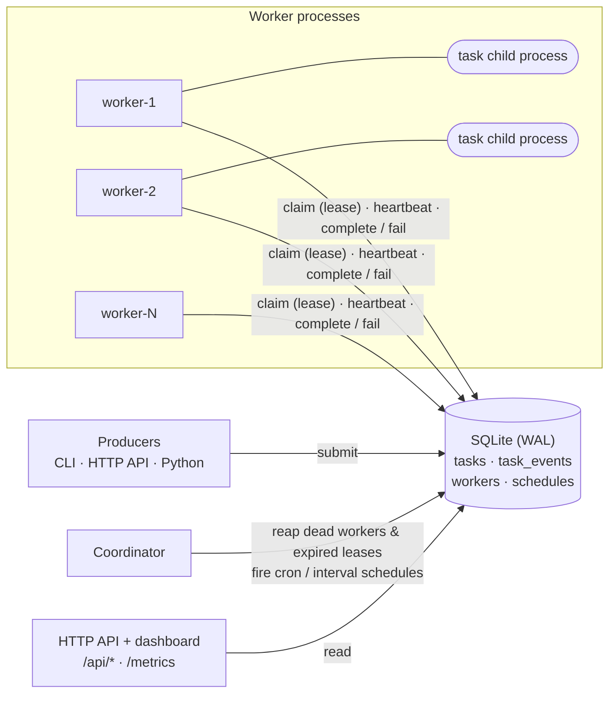
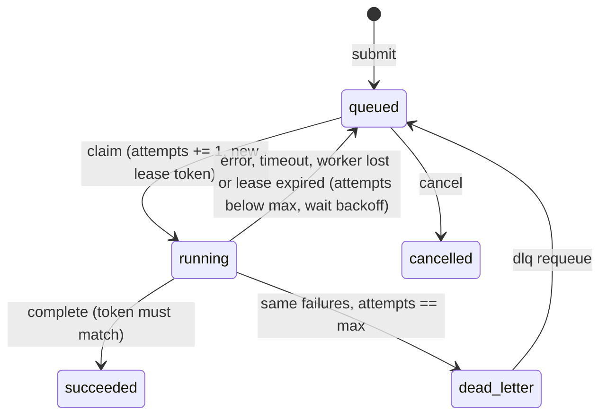

# dtsched: a distributed task scheduler

[](https://github.com/lollipop-tart/distributed-task-scheduler/actions/workflows/ci.yml)

A small distributed job queue in pure Python. You submit tasks, and a pool of
worker processes runs them. The scheduler handles crashes, hangs and errors:

- **Priorities and scheduling.** Higher priority runs first. Tasks can be delayed or given a
  start time, and recurring jobs can use cron expressions or fixed intervals.
- **Distribution.** Any number of worker processes pull from one shared queue.
  Each claim is atomic, so a task never goes to two workers at once.
- **Failure detection.** Workers send heartbeats. If a worker goes silent, the
  coordinator declares it dead and re-queues its tasks. Every claim is a
  time-limited *lease* with a fencing token, so a late result from a "dead" worker is rejected.
- **Retries.** Failures are retried with exponential backoff and jitter, up to a
  `max_attempts` limit. Tasks that run out of attempts go to a **dead-letter queue**, where you can inspect them and re-queue them.
- **Timeouts.** Each task runs in its own child process, which is killed if it
  runs past its timeout.
- **At-least-once delivery** with idempotency keys. The section [Delivery semantics](#delivery-semantics) explains this.
- **Monitoring.** A CLI (`dtsched status`), a JSON HTTP API, a Prometheus
  `/metrics` endpoint and a live HTML dashboard.

There are no runtime dependencies. The only infrastructure it needs is a SQLite file.

## Quick start

```bash
git clone https://github.com/lollipop-tart/distributed-task-scheduler.git
cd distributed-task-scheduler
python -m venv .venv && source .venv/bin/activate
pip install -e ".[dev]"

python examples/demo.py          # 3-worker cluster with injected failures (~6 s)
```

To run a cluster by hand, use separate terminals. Every command uses the same database file:

```bash
export DTSCHED_DB=./tasks.db

dtsched run --workers 3                # coordinator + 3 workers + dashboard on :8080
# ...or run each piece separately:
dtsched coordinator
dtsched worker                         # start as many as you like

dtsched submit dtsched.examples:add 2 3 --priority 5
dtsched submit dtsched.examples:flaky 3 --max-attempts 5 --backoff-base 0.5
dtsched submit dtsched.examples:sleep 60 --timeout 2          # will time out
dtsched submit dtsched.examples:add 1 1 --delay 30
dtsched submit dtsched.examples:add 1 1 --idempotency-key report-2026-10-23
dtsched schedule add nightly dtsched.examples:add 0 0 --cron "0 3 * * *"
dtsched schedule add pulse dtsched.examples:add 0 1 --every 10

dtsched status --watch 1               # live queue depth, failures, workers
dtsched tasks --state dead_letter
dtsched show 7                         # one task and its full event history
dtsched dlq requeue --all              # give dead-lettered tasks another go
```

A task is any importable function with JSON-serialisable arguments and return
value. Refer to it as `"package.module:function"`. If the function has a `ctx`
parameter, it receives the task id, the attempt number and the worker id:

```python
def send_invoice(invoice_id: str, ctx) -> dict:
    # ctx.attempt is 1 on the first try, 2 on the first retry, ...
    return {"invoice": invoice_id, "attempt": ctx.attempt}
```

From Python:

```python
from dtsched import Store

store = Store("tasks.db")
res = store.submit(
    "myapp.jobs:send_invoice",
    ["INV-42"],
    priority=10,
    max_attempts=5,
    timeout=30,
    idempotency_key="invoice:INV-42",
)
store.get_task(res.task_id).state  # queued -> running -> succeeded
```

## Architecture



The **store** (`store.py`) is the single source of truth. Every state change is
one short `BEGIN IMMEDIATE` transaction. That takes SQLite's write lock at the
start, so concurrent claims are serialised and each task goes to exactly one
claimant. WAL mode lets the dashboard and CLI keep reading during writes.

**Workers** (`worker.py`) poll for the highest-priority due task and claim it
under a lease. They run it in a `spawn`ed child process and report the result.
A background thread sends a heartbeat every `heartbeat_interval`. Each heartbeat renews the
leases the worker holds and also tells the worker which tasks it *still* owns.

The **coordinator** (`coordinator.py`) is a housekeeping loop and is not on the
hot path. It declares workers dead when their heartbeats stop, recovers their
tasks and any expired leases, and fires schedules. Every step is idempotent, so
running two coordinators is safe, and restarting one loses nothing.

### Task life cycle



## Delivery semantics

**dtsched is at-least-once.** A task is marked done only after the worker
reports success. If the worker crashes at any point before that, even right
after the task's side effect has happened, the lease expires and the task runs
again. The alternative is to mark a task done when it is *taken*. That gives
at-most-once delivery, and a crash then silently loses work. For most
background jobs, losing work is worse than repeating it.

Exactly-once execution is impossible in general across a network that can fail.
The worker can't atomically "do the side effect" and "tell the queue it did it".
What you can get is **exactly-once *effect***: at-least-once delivery plus
**idempotent tasks**. dtsched helps in three places:

1. **Idempotent submission.** `idempotency_key` is unique. A producer that
   retries a submit (after a timeout, say) gets the existing task back instead
   of creating a duplicate. Schedules use this too, so two coordinators can't
   fire the same occurrence twice.
2. **Fencing tokens.** Every claim issues a new random `lease_token`, and
   `complete`/`fail` are accepted only from the current holder. Take a worker that was
   paused (GC, network partition) and presumed dead. It can't overwrite the result
   of the retry that replaced it. Its stale result is discarded and counted in
   `stale_completions`.
3. **Idempotent task design.** `ctx.task_id` and `ctx.attempt` are passed to
   the task. The demo's `charge` task keys its ledger write on `order_id`
   (`INSERT OR IGNORE`). When its worker is SIGKILLed after charging but before
   reporting back, the task runs twice and the customer is charged once:

```
At-least-once + idempotency (payment task):
  task executions: 2   ledger rows: [('order-1001', 4999)]
```

## The demo

`python examples/demo.py` starts a coordinator and 3 workers, then queues
12 tasks and an interval schedule. While they run, it SIGKILLs the worker that is handling a payment.
Here is an excerpt from a real run:

```
[t+ 0.7s] injected failure: SIGKILL worker-2 mid-payment

t+ 0.09s  #5   urgent (pri 10)    claimed          worker-1
t+ 0.09s  #9   payment            claimed          worker-2
t+ 0.09s  #1   batch-0 (pri 0)    claimed          worker-3
t+ 1.18s  #6   flaky              failed           worker-3  ConnectionError: simulated transient failure on attempt 1
t+ 1.18s  #6   flaky              retry_scheduled            next attempt in 0.22s
t+ 1.47s  #6   flaky              failed           worker-1  ConnectionError: simulated transient failure on attempt 2
t+ 1.47s  #6   flaky              retry_scheduled            next attempt in 0.32s
t+ 1.83s  #7   always-fails       failed           worker-1  RuntimeError: this task always fails
t+ 1.83s  #7   always-fails       dead_lettered              gave up after 3 attempt(s)
t+ 1.89s  #6   flaky              succeeded        worker-1  0.05s
t+ 1.91s  #9   payment            worker_lost      worker-2  worker worker-2 stopped heartbeating
t+ 1.91s  #9   payment            retry_scheduled            next attempt in 0.18s
t+ 2.10s  #9   payment            claimed          worker-1
t+ 2.19s  #8   hangs              timeout          worker-3  timed out after 1s
t+ 3.47s  #8   hangs              timeout          worker-3  timed out after 1s
t+ 3.47s  #8   hangs              dead_lettered              gave up after 2 attempt(s)
t+ 5.20s  #9   payment            succeeded        worker-1  3.10s

Queue depth 0 ready, 0 delayed (0 awaiting retry)
Tasks       0 running, 12 succeeded, 2 dead-lettered, 0 cancelled
Failures    6 retries, 2 timeouts, 1 lost to dead workers, 0 stale results discarded
Latency     p50 0.09s, p95 3.10s; throughput 12.0/min

WORKER    STATE  PID   HEARTBEAT  TASK  OK  FAILED
--------  -----  ----  ---------  ----  --  ------
worker-1  alive  4349  0.1s ago   -     7   4
worker-3  alive  4351  0.1s ago   -     5   3
worker-2  dead   4350  5.0s ago   -     0   0
```

The `urgent (pri 10)` task is claimed first even though it was submitted after
the `batch` tasks. Exact timings vary from run to run. Use `--serve` to keep
the dashboard open afterwards.

## Monitoring

| Interface | What it shows |
|---|---|
| `dtsched status [--watch N] [--json]` | queue depth, task counts by state, retries/timeouts/lost workers, p50/p95 latency, throughput, per-worker heartbeat age and counters |
| `dtsched tasks --state S`, `dtsched show ID` | task list; one task's full event history (claimed, failed, retry_scheduled, ...) |
| `GET /` | live HTML dashboard (polls the API every 2 s) |
| `GET /api/stats`, `/api/workers`, `/api/tasks`, `/api/tasks/ID`, `/api/dead-letter` | the same data as JSON |
| `POST /api/tasks`, `POST /api/dead-letter/ID/requeue` | submit and requeue over HTTP |
| `GET /metrics` | Prometheus text format (`dtsched_tasks{state=...}`, `dtsched_queue_depth`, `dtsched_retries_total`, ...) |

## Design choices and trade-offs

**Why SQLite rather than Redis, RabbitMQ or Postgres?** The goal was a scheduler you
can clone and run, with tests that start real processes and kill them, without
Docker or a paid service. SQLite with `BEGIN IMMEDIATE` gives real ACID
transactions across processes. That makes the claim/lease logic easy to read
and easy to test. Redis would need Lua scripts or `BRPOPLPUSH` patterns to get the same atomicity. The
store is the only module that touches SQL, so a Postgres backend (using
`SELECT ... FOR UPDATE SKIP LOCKED`) could replace it without changing workers.

**Pull, not push.** Workers ask for work when they are free. The coordinator
never has to track worker capacity, and a slow worker just takes less work. The
cost is polling latency (`--poll`, 0.2 s by default) and some idle database reads.

**Process per task.** A Python thread can't be killed, so a timeout enforced
by a thread would leave the hung code running. Each task runs in a `spawn`ed
child process, which costs about 50–80 ms of start-up per task on a laptop. That's fine for
background jobs. It's too slow for thousands of tiny tasks per second, where you'd keep a
pool of warm processes instead. If the worker is SIGKILLed, the child notices it has been re-parented
and exits, so orphans don't keep running.

**Leases plus heartbeats.** Heartbeats detect a dead *worker*. Leases bound how
long any single *claim* can live. Fencing tokens make sure a late reply can't do damage.
Detection time is a trade-off. A short `worker_timeout` recovers tasks quickly
but risks declaring a slow worker dead. That case is safe, because the late result is
fenced off, but it wastes work.

**Equal-jitter backoff.** `delay = min(cap, base·2^(n-1))`, drawn uniformly from
`[delay/2, delay]`. The jitter de-synchronises retries after a shared outage,
and the lower bound still guarantees a minimum wait.

**Crash = failed attempt.** A task whose worker died counts against
`max_attempts`. That stops a "poison pill" task (one that crashes every worker that runs it) from looping
forever. The cost is that a task can be dead-lettered because of infrastructure trouble rather
than its own bug. `dtsched dlq requeue` is the escape hatch.

## Limitations

- **Single machine, or a shared disk.** SQLite file locking isn't reliable over
  NFS, so workers on other hosts would need the Postgres-style backend
  described above. "Distributed" here means separate processes that coordinate only
  through shared state, which is the same failure model as separate hosts.
- **Throughput.** All writes go through one database lock. Expect hundreds of
  tasks per second, not tens of thousands.
- **One task at a time per worker.** You get concurrency by running more
  workers.
- **Trusted producers only.** A task name is an import path that workers will
  import and call. Don't expose `POST /api/tasks` to untrusted clients.
- **JSON only.** Arguments and results must be JSON-serialisable. Large
  results should go to blob storage, with a reference returned instead.
- **No authentication** on the HTTP API. It binds to 127.0.0.1 by default.
- **Clock assumptions.** Leases compare timestamps written by different processes.
  On one machine that's the same clock. Across hosts, lease TTLs need to be much larger than clock skew.

## Project layout

```
src/dtsched/
  store.py        SQLite schema and every state transition (claim, lease, retry, reap, DLQ, stats)
  worker.py       worker loop, heartbeat thread, child-process execution with timeout
  coordinator.py  dead-worker / expired-lease reaper and schedule firing
  backoff.py      exponential backoff with jitter
  cron.py         5-field cron parser
  api.py          HTTP API, Prometheus metrics, dashboard
  cli.py          `dtsched` command
  cluster.py      launch a local coordinator + N worker processes
  examples.py     demo tasks (flaky, always_fails, sleep, crash, idempotent charge)
examples/demo.py  end-to-end failure demo
tests/            90 tests
```

## Tests

```bash
pytest -q          # 90 tests, ~25 s
ruff check . && ruff format --check .
```

- `test_store.py` drives the state machine with a **fake clock**, so leases,
  backoff, dead-worker detection and schedules are tested exactly and instantly. It
  also includes a test with 8 threads racing to claim 200 tasks, checking that none is claimed twice.
- `test_worker.py` uses real child processes to cover success, exceptions, timeouts,
  hard crashes (`os._exit`), non-JSON results, a lease taken away mid-task and
  graceful shutdown.
- `test_failure_injection.py` starts a real coordinator and 3 worker processes,
  then **SIGKILLs workers mid-task**. It checks that the task is reassigned, that the orphaned
  task process exits, that an idempotent task charges exactly once despite
  running twice, and that the cluster survives losing 2 of 3 workers or all of them.
- `test_api_cli.py` covers the HTTP endpoints and CLI commands.

CI runs lint, the tests and the demo on Python 3.10, 3.12 and 3.13.

## License

MIT. See [LICENSE](LICENSE).
